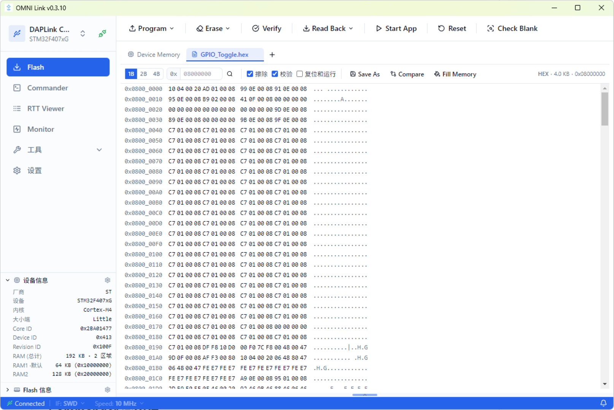

# Flash

Flash 页面提供固件烧录、擦除、校验、回读、Hex 查看等功能，对标 SEGGER J-Flash。

## 界面布局

左侧设备面板显示探针连接状态与目标芯片信息，底部折叠面板展示厂商、内核、Flash 容量、Core ID、Device ID、RAM 等设备参数。主工具栏横向排列 Program、Erase、Verify、Read Back、Start App、Reset、Check Blank 等操作按钮。中央 Hex 查看器支持 1B/2B/4B 分组显示与 ASCII 对照。底部状态栏持续展示 Backend 在线状态、SWD 接口、通信速率与连接指示。

## 连接探针与选择目标

顶部设备切换器自动检测已连接的探针。选择探针后，应用尝试自动识别目标芯片型号。若识别为通用 `cortex_m`，需在左侧设备面板手动选择具体型号（如 `apm32f407xg`），否则 Flash 布局信息不可用。

## 加载固件文件

点击工具栏的打开文件按钮，或拖拽文件到 Hex 查看器区域，支持以下格式：

- **.bin** — 原始二进制，烧录地址默认为 Flash 起始地址
- **.hex** — Intel HEX，包含地址信息
- **.elf** — 可执行链接格式，包含段信息与符号表

加载后 Hex 查看器切换到 `file` tab 展示文件数据，顶部标签栏显示文件名与基地址。

## 烧录固件

1. 加载固件文件
2. 点击工具栏 **Program** 按钮
3. 进度条显示擦除、编程、校验三个阶段的实时进度
4. 完成后日志区输出烧录结果与耗时

勾选 Program 旁的 Verify 选项可在烧录后自动校验。勾选 Reset 选项可在烧录后自动复位目标。

## 擦除

点击 **Erase** 按钮弹出擦除选项：

- **Chip Erase** — 擦除整片 Flash
- **Sector Erase** — 擦除指定扇区
- **Sector Range** — 擦除指定扇区范围

擦除行为与 Commander 的 `erase` 命令一致，直接操作 `boot_memory` 的 Flash 实例。

## 校验与空白检查

- **Verify** — 将设备 Flash 内容与已加载的文件数据逐字节比对
- **Check Blank** — 检查 Flash 是否为全 0xFF（空白状态）

## 回读

点击 **Read Back** 按钮从设备 Flash 读取数据。读取完成后 Hex 查看器切换到 `device` tab 展示回读数据。`file` 与 `device` 两个 tab 独立管理，可随时切换对比。

## Hex 查看器

Hex 查看器顶部可切换 `file`/`device` 两个数据 tab，右侧提供分组显示选项（1B/2B/4B）。每行显示地址、十六进制数据、ASCII 对照三列。支持滚动浏览与搜索定位。

## Fill Memory

Fill Memory 仅操作当前 tab 的内存数据（文件数据或回读数据），不会直接编程到设备。填充后的数据需通过 Program 操作才会写入 Flash。

## Compare

Compare 将当前 tab 的数据（文件或回读的 Flash）与另一个固件文件逐字节比对，差异字节以红色高亮显示。

比对按**绝对地址**对齐，而不是按文件偏移：

- 起始地址默认为当前 tab 的基地址；`.axf` / `.elf` / `.hex` 使用文件自带地址，`.bin` 按对话框里填写的地址加载；
- 两侧都裁剪到同一地址窗口，窗口外没有数据的字节显示为空白，只有一侧有数据时统计为「仅左侧 / 仅右侧」；
- 比较完成后视图自动滚动到首个差异的地址（没有差异时停在比较起始地址）。

> 比较大小留空时，窗口覆盖两侧数据范围的并集；地址范围完全不重叠时不会产生「逐字节差异」。

> Flash 操作与 Monitor 采样互斥。执行 Flash 操作时，Monitor 会自动暂停采样；操作完成后自动恢复。
