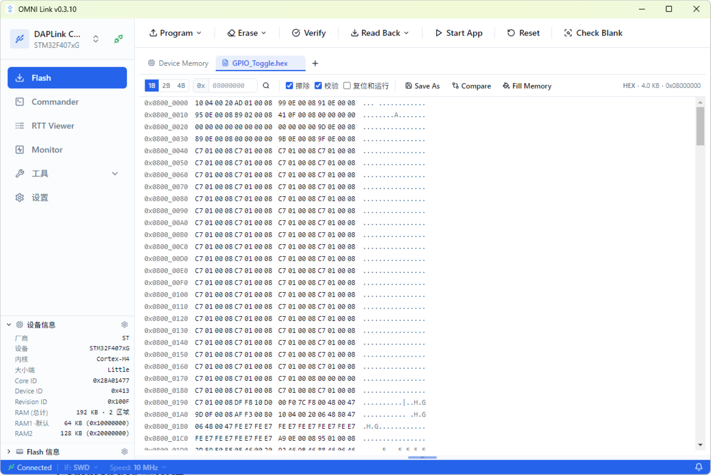
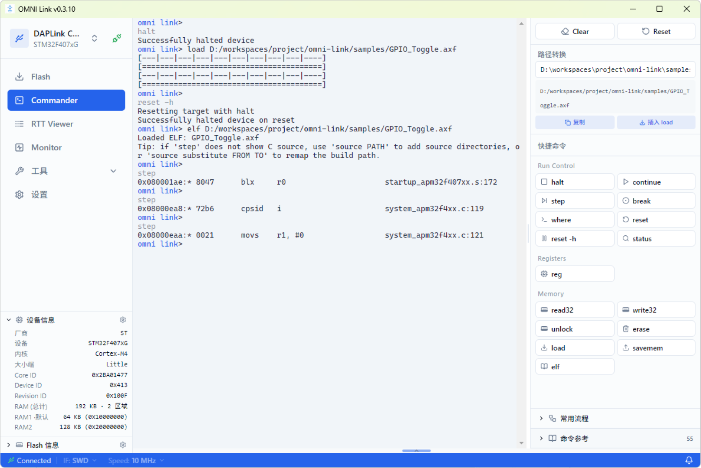
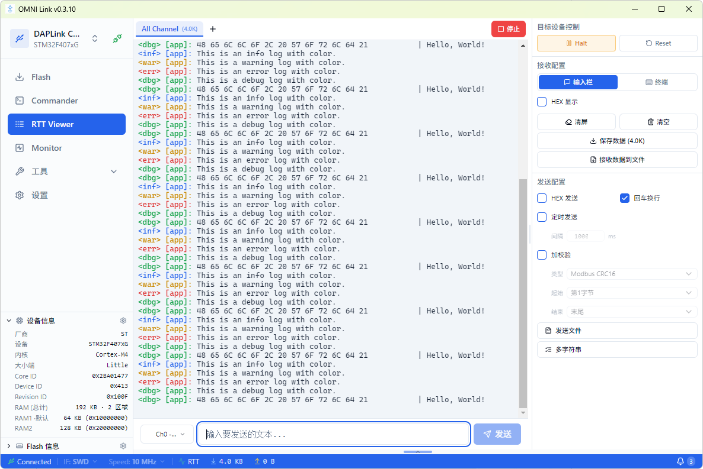
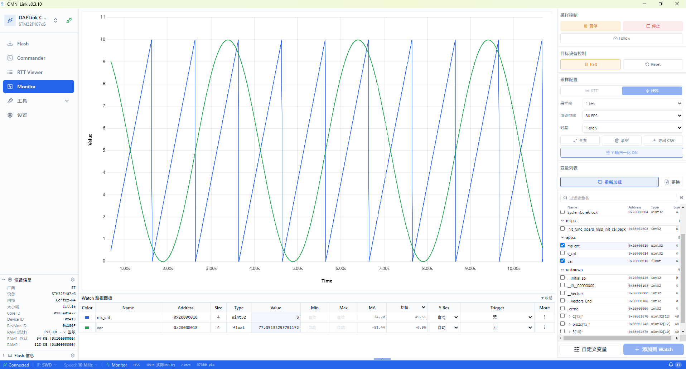
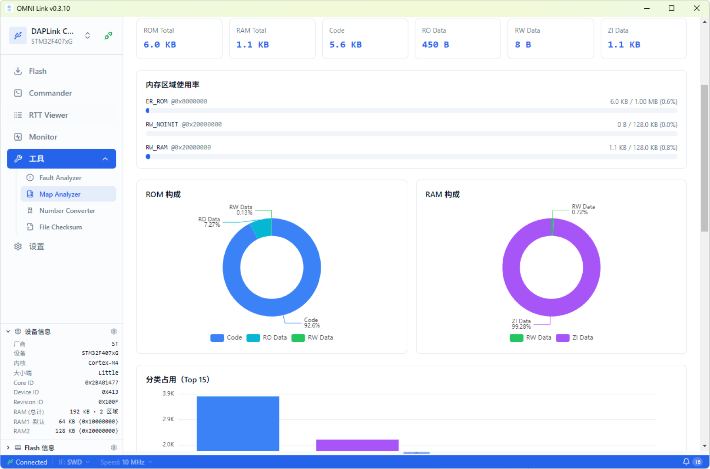
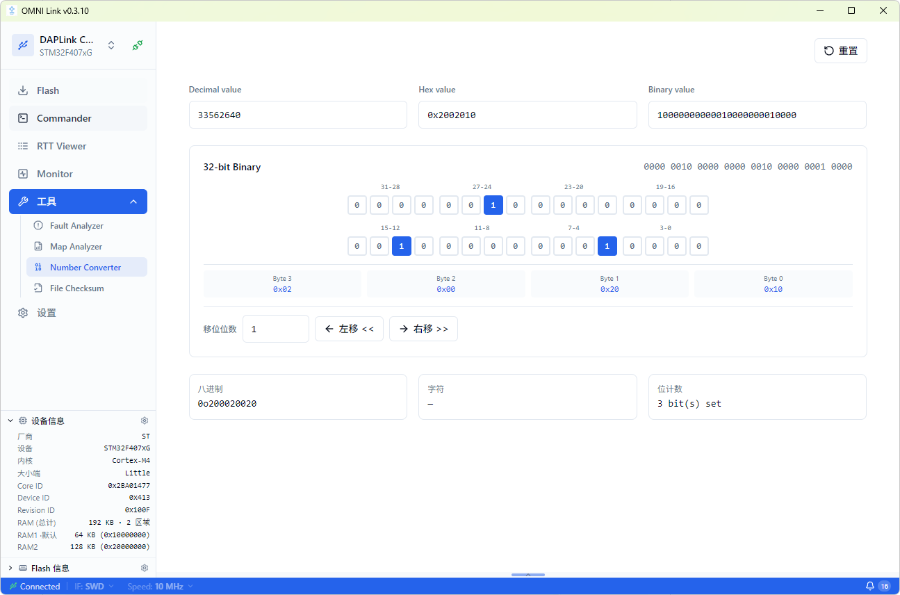

# 功能模块详解

本文档详细介绍各功能页面的技术实现与设计思路。功能概览见 [首页](../index.md)。

## Flash 页

左侧导航栏显示已连接的探针（DAPLink）与目标芯片型号，底部折叠面板展示厂商、内核、Flash 容量、Core ID、Device ID、RAM 等设备信息。主工具栏横向排列 Program、Erase、Verify、Read Back、Start App、Reset、Check Blank 等操作按钮。中央 Hex 查看器支持 1B/2B/4B 分组显示与 ASCII 对照，顶部可切换 file/device 两个数据 tab，配合 Fill Memory、Compare、Save As 完成数据级操作。底部状态栏持续展示 Backend 在线状态、SWD 接口、通信速率与连接指示。

- **功能**：固件烧录、擦除（chip/sector）、校验、回读、Hex 查看器（支持 1B/2B/4B 分组显示）、Fill Memory（纯前端数据操作）、Compare（文件与设备/数据对比）
- **技术栈**：Zustand `flash.store`、shadcn/ui、自定义 `HexViewer` 组件、`react-resizable-panels` 面板布局
- **关键组件**：`FilePanel`、`HexViewer`、`TabBar`、`FlashProgress`、`InfoPanel`、`LogConsole`、`CompareView`、`ProbeSelector`、`TargetSelector`
- **设计思路**：
  - tab 管理（`file`/`device`）区分文件数据视图与设备回读数据视图
  - `wrapOperation` 统一封装 Flash 操作，处理进度回调与异常
  - 通过 `monitor_backend.pause_during` 与 Monitor 互斥，避免总线冲突
- **注意**：Fill Memory 仅操作当前 tab 的内存数据，不会直接编程到设备；需通过烧录动作才会写入 Flash

## Commander 页

中央终端区域复用 pyOCD Commander 的交互式 REPL，执行 `halt`、`load`、`reset`、`step` 等命令后自动输出反汇编结果，指令行附带源文件名与行号标注（如 `system_stm32f4xx.c:168`），并在右侧注释中显示对应的 C 代码片段。右侧命令面板将 halt/step/where/reset 等命令归类为快捷按钮，路径切换区可快速加载 ELF 文件，「常用流程」区将调试、断点调试、解锁刷写三套多步操作链封装为可单击的工作流。

- **功能**：交互式命令行，复用 pyOCD Commander REPL，支持 `reg`、`read32`/`write32`、`halt`/`continue`、`step`、`load`、`erase`、`disasm`、`where`、`symbol`、`elf`、`source` 等命令
- **技术栈**：xterm.js 5（`@xterm/xterm` + addon-fit + addon-web-links）、Zustand `commander.store`、keep-alive 机制
- **关键组件**：`Terminal`（xterm 封装）、`CommandSidebar`（命令列表与帮助）
- **设计思路**：
  - `erase` 命令直接操作 `boot_memory` 的 Flash 实例（与 Flash 页一致），而非 `FlashEraser`，保证擦除行为与 Flash 页统一
  - `source` 命令参考 GDB `directory`/`substitute-path` 设计，解决跨机器源码路径映射问题，配合 `where`/`disasm` 显示源码
- **注意**：Commander 采用 keep-alive 机制，切走页面时使用 `display:none` 保留 xterm 实例与会话状态，切回时无需重新连接

## RTT Viewer 页

中央终端区域以多 tab 方式管理 RTT 通道，支持「All Channel」汇总视图与单通道切换。终端输出按日志级别着色：info 为蓝绿、debug 为青、warn 为黄、err 为红，HEX dump 行同时显示原始字节与 ASCII 对照。右侧配置面板分为接收配置（输入栏、回车换行、HEX 显示、数据保存）、发送配置（HEX 发送、定时发送、间隔设置）、协议层（协议类型、校验方式、字节序）三组，顶部红色停止按钮一键终止会话。底部状态栏实时显示 Backend 在线、SWD 接口、RTT 数据速率与帧计数。

- **功能**：SEGGER RTT 实时数据收发，多 tab 通道管理，terminal/bar 两种输入模式，文件发送，录制到 `.dat` 文件
- **技术栈**：xterm.js 5、Zustand `rtt.store`、`useRttSession` 全局会话 hook（跨页面不停止）
- **关键组件**：`RttTerminal`、`RttTabBar`、`ConfigPanel`、`InputBar`、`SendFileButton`、`SaveFormatDialog`、`MultiStringDialog`
- **设计思路**：
  - RTT 会话在 `MainLayout` 顶层启用，切页面不中断数据流
  - 启动有 30 秒超时保护；超时/停止会取消后台启动流程（避免前端已报失败、稍后又"启动成功"）
  - 控制块扫描按「ELF 符号 → 主 SRAM 优先」顺序进行，不可读 RAM 区段快速跳过（不再逐 64 字节刷屏）
- **注意**：若外部工具（如 IDE 调试器、其他 RTT 客户端）占用调试接口，会导致 SWD 挂起，需依赖超时保护并提示用户释放接口

## Monitor 页

中央波形图基于 uPlot 渲染，纵轴为变量值、横轴为时间，网格线辅助读数，顶部标注当前采样点数（如 10952 个采样点）。右侧面板分为可视化控制区（暂停/开始、缩放范围、刷新频率、Y 轴、过滤设置）与变量树。变量树按源文件分组（如 `main.c`、`system_stm32f4xx.c`、`app.c`），勾选复选框即可将变量加入监视。底部 Watch 表格实时显示变量名称、颜色标识、地址、类型、当前值、最小/最大值、移动均值等列，支持 CSV 导出。

- **功能**：变量实时监控与波形采样，DWARF 符号解析（自动从 ELF 提取变量地址），SWD/RTT 两种传输模式，触发（上升沿/下降沿/阈值），游标测量，CSV 导出
- **技术栈**：uPlot 1.6（波形渲染）、Zustand `monitor.store`、WebSocket 实时推送采样数据
- **关键组件**：`WaveformChart`（uPlot 封装）、`ChannelPanel`（通道配置）、`WatchPanel`（变量监视列表）
- **设计思路**：
  - HSS（High-Speed Sampling）异步采样模式：非侵入，通过 SWD 周期性读取内存，适合长期监控
  - RTT 模式：侵入但快速，目标程序主动推送数据，适合高频采样
  - `pause_during` 与 Flash/Commander 互斥，避免调试总线冲突
- **注意**：
  - HSS 模式实际采样率受 SWD 带宽限制，并非标称值
  - 采样率与信号频率的整数倍关系会导致混叠（aliasing），需合理选择采样率

## Tools 页

工具集页面，包含四个独立子工具：

### Map Analyzer

顶部指标卡汇总 ROM Total、RAM Total、Code、RO Data、RW Data、ZI Data 六项关键数值。中部内存区域使用率以进度条展示 ER_IROM1（Flash）与 RW_IRAM1（RAM）的占用比例。下方双环形图分别展示 ROM 构成（Code/RO Data/RW Data 占比）与 RAM 构成（ZI Data/RW Data/RO Data 占比），底部柱状图按模块分类排列 Top 15 占用，柱段以颜色区分 Code/RO Data/RW Data/ZI Data，帮助快速定位体积异常的代码段。

- **功能**：ARM `.map` 链接器输出文件解析与可视化（基于 ECharts 6），分析 ROM/RAM/Stack 占用分布、各 section 大小、符号表

### Fault Analyzer

- **功能**：Cortex-M 故障寄存器分析，解析 CFSR/HFSR/MMFSR/BFSR/UFSR 等故障状态寄存器，定位 fault 类型与原因

### Number Converter

顶部三栏输入框（十进制值、十六进制值、二进制值）实时联动，编辑任一字段其余自动更新。中部 32-bit 位网格按 4 位一组排列，标注位位置（31-28 至 3-0），置位为 1 的格子以蓝色高亮，可逐位点击翻转。下方字节分解行显示 Byte 3 至 Byte 0 的十六进制值，底部输出八进制、ASCII 字符与置位计数。

- **功能**：十进制/十六进制/二进制互转，纯前端计算，无后端依赖，支持 32 位逐位编辑

### File Checksum

- **功能**：CRC32/MD5/SHA-1/SHA-256 校验和计算，基于浏览器 SubtleCrypto API 与前端 CRC 实现

## Settings 页

- 终端主题选择（影响 Commander / RTT 终端配色）
- 版本信息展示（前端 `package.json` 版本 + 后端 `BACKEND_VERSION`）
